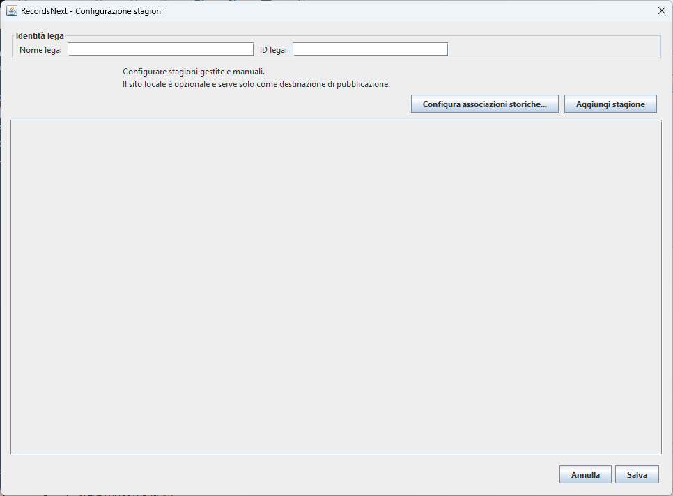
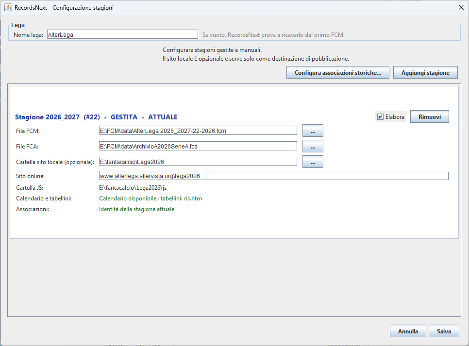
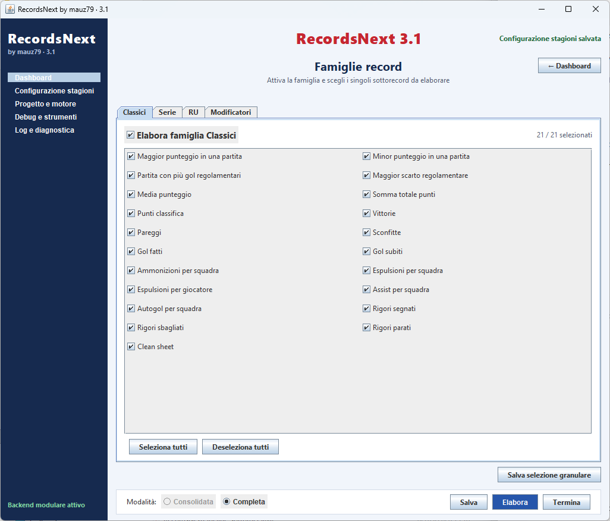
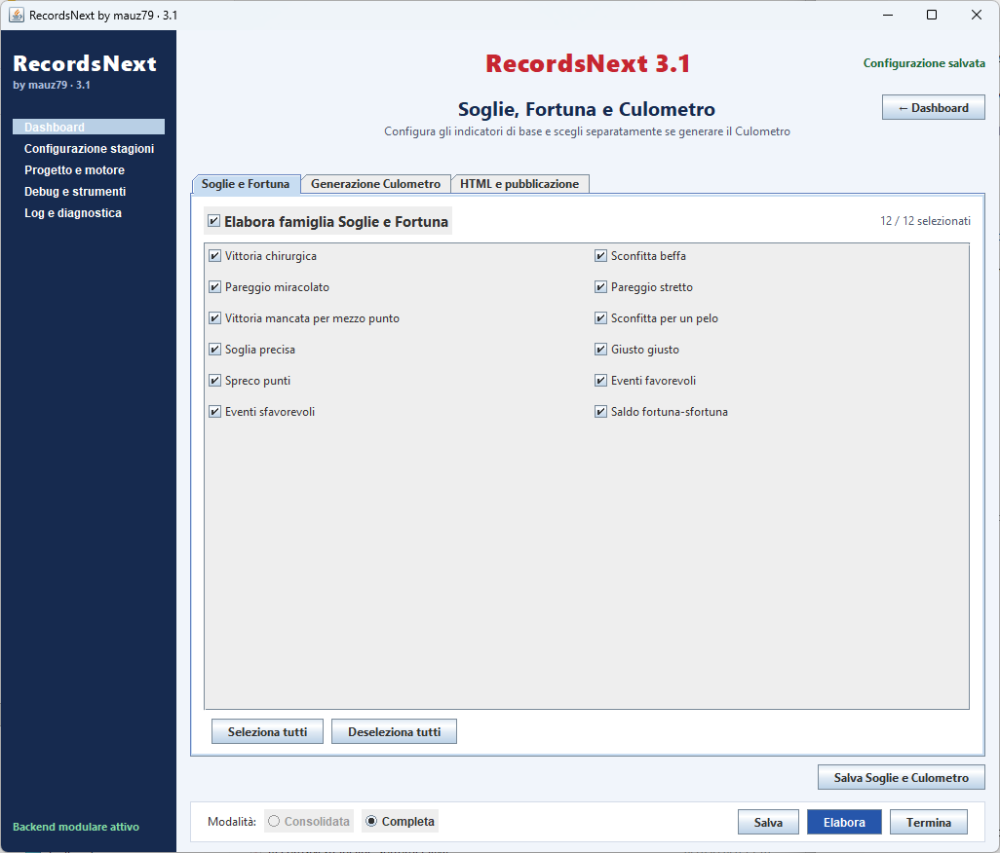
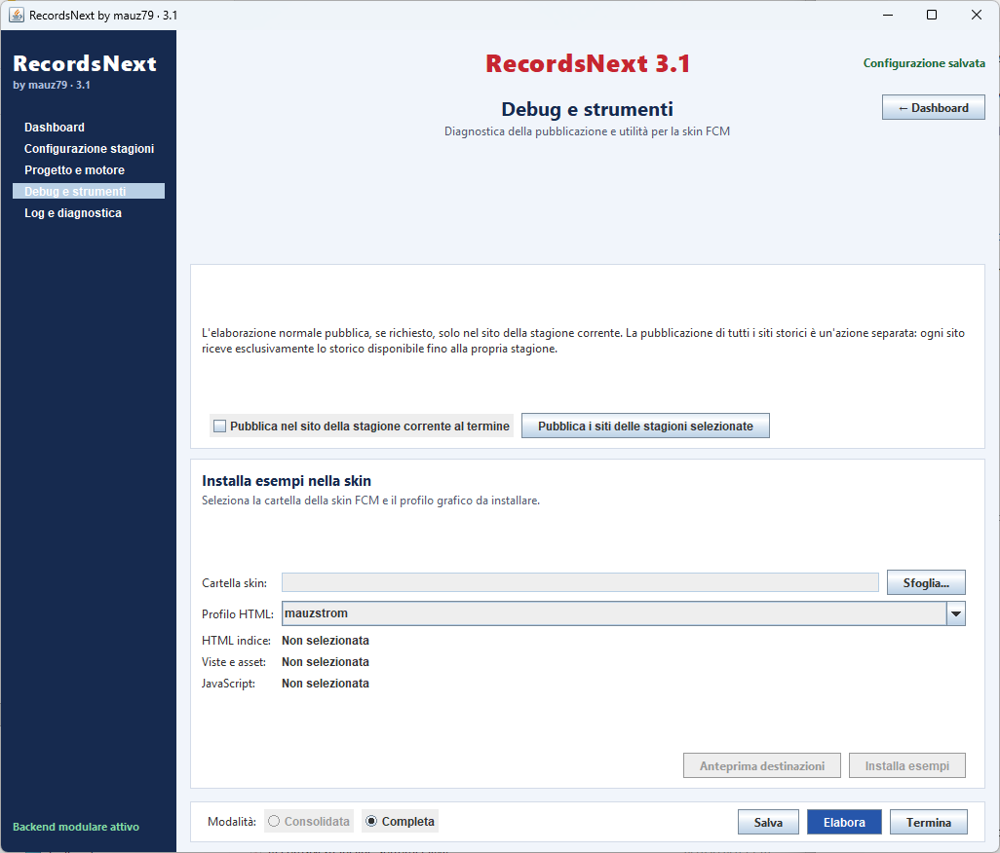
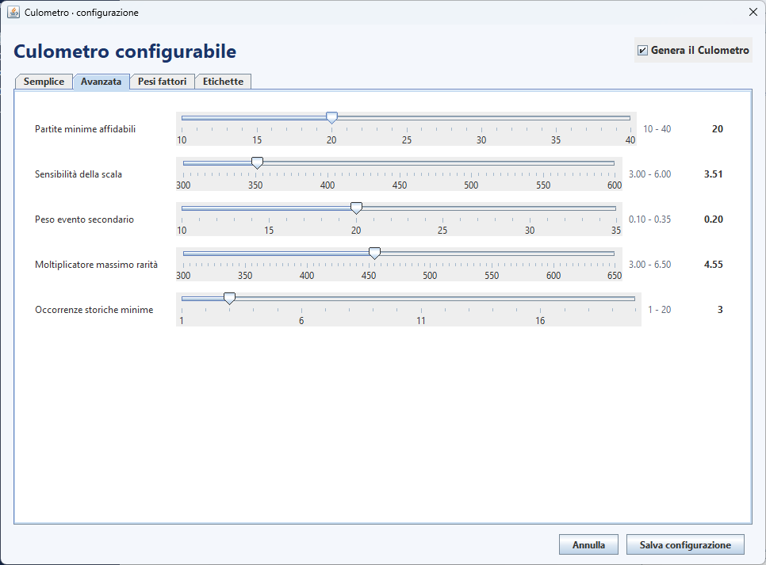

# RecordsNext 4.0 v49 — soglie GUI, riconciliazione e diagnostica tribuna (TEST)

**Stato 12/11/2026:** v48 ha completato sul Windows dell'utente 87 record, 302 JS validi, 0 pubblicati. v49 non modifica le formule TF11–TF13 o l'archivio: rende le soglie davvero accessibili, impedisce la richiesta ripetitiva di riconciliazione e aggiunge alla facade un audit separato sulle tribune possibili. **Non afferma che tutte le esclusioni storiche siano provate.**

- 11 soglie numeriche visibili nella scheda senza scorrimento orizzontale, salvataggio invariato `config/topflop.json`.
- Riconciliazione solo tramite pulsante, nessuna approvazione automatica, registro identita' invariato.
- `fcmRecordsNext_TopFlopViews.js`: in ogni stagione `contatori.auditTribuna` distingue chi figura in un'altra formazione della stessa squadra e giornata dai soli nominativi del tesseramento stagionale. **Contatori diagnostici, non record TF11-TF13.**
- Leggere [verifica e limiti v49](docs/VERIFICA_TRIBUNA_GUI_v49.md), [bibbia v41](docs/CODICE_FUNZIONANTE_RECORDSNEXT4_v41.md).
- Sorgenti 3.2, FCM/FCA, SQLite, identita' e siti operativi non vengono alterati dall'installazione. Pubblicazione sempre disabilitata nel TEST.

---

# RecordsNext 4.0 v48 — TF11–TF13 con panchina FCM verificata (solo TEST)

**Stato 12/11/2026:** v47 gia' collaudata via GUI su Windows con **83 record e 282 JS validi, 0 pubblicati**. v48 aggiunge i 3 record TF11–TF13 in perimetro documentato e corregge etichette TF14/15. La v48 e' compilata e testata offline; necessita collaudo GUI Windows, quindi non e' ancora release pubblica.

- TF11 `S_V/P_V`, TF12 `S_V/E`, TF13 `S_F/P_F` e `S_F/E`, **solo** riserve presenti nella formazione FCM di incontro giocato, non conteggiate nel tabellino, senza ingresso. Non si inferiscono giocatori assenti dalla formazione: la copertura non e' completa e viene dichiarata in JSON.
- L'algoritmo separa stagione, calciatore, squadra, competizione e famiglia e applica le soglie salvate nella GUI; conserva pareggi e link a tabellini canonici quando presenti.
- Nuovi shard lazy `Bench`, adattatore di pubblicazione compatibile con cutoff multisito e decoder V2 aggiornato. Limite fisico 1.500.000 byte per JS invariato.
- Nessuna modifica a SQLite, registri identita', configurazioni personali, FCA/FCM o engine Classics. L'indice economico e' ancora non confrontabile e la fantamedia reale necessita regolamento verificato, come in v47.

Documento tecnico: [verifica panchina v48](docs/VERIFICA_TF11_TF13_PANCHINA_v48.md); [bibbia v40](docs/CODICE_FUNZIONANTE_RECORDSNEXT4_v40.md).

---

# RecordsNext 4.0 - v47 / completamento metriche Top & Flop (TEST)

**Stato 12/11/2026:** codice Java 21 compilato e smoke test offline superati; **NON ancora collaudato con elaborazione GUI su Windows v47, NON pubblicato sui siti, NON versione stabile**. La v46 ha già completato l'elaborazione reale Windows di 80 record con 261 JS validi, ma non sostituisce il collaudo della v47.

## Funzionalità introdotte nella v47

- **TF14/TF15**: rendimento reale stagionale eccezionale/flop con confronto *leave-one-season-out*; baseline di altre stagioni ponderata sui voti validi, soglie configurabili `anomalySeasonVotes=8`, `anomalyBaselineVotes=20`, `anomalyBaselineSeasons=2`, `anomalyDelta=0.75`. Solo identità storiche **esplicitamente approvate** e stagione nel cutoff del singolo sito. Graduatorie `storico.recordStorici` nella facade e dettaglio `History.anomalieStagionali`; selezione tramite GUI. Nessun collegamento automatico per nome/codice Gazzetta.
- **Costi storici**: nuovi shard `Economy` per stagione caricabili a richiesta; ogni riga conserva `playerKey`, squadra, ID tesserato, costo acquisto/cessione, zero distinto da dato mancante, anomalie costo oltre `CREDITITOTALI`. La somma e media prezzo nei profili usano solo valori di acquisto **positivi**. Non si presume che un contratto annuale provi il possesso in una specifica giornata.
- **Fantamedia reale indipendente**: nuovo lettore opzionale `config/topflop-real-rules.json` con regolamenti **stagionali documentati, esplicitamente confermati e completi**. Solo allora la v47 genera shard `RealFantasy`; il calcolo usa un unico giorno FCA (non `TOT` fantasy) e non conta doppiamente i rigori compresi nei gol. Senza regola comprovata, media e copertura restano **null / NON_VERIFICABILE**; una carriera multistagionale mostra un valore globale solo con copertura completa dei voti reali.
- **Decoder browser v2**: `visualizzatori/js/fcmRecordsNextTopFlopViewsDecoder-v2.js` mantiene la lettura lazy delle vecchie viste e supporta `Economy`, `RealFantasy`, storico e record TF14/TF15. Il decoder v1 rimane disponibile per compatibilità.
- **TF05/TF06**: medie già implementate nella v46, mantenute con soglie e denominatori reali; TF11-TF13 restano volutamente **NON ATTIVI** finché non è dimostrabile l'esclusione e il possesso al giorno. L'**indice economico interstagionale** rimane `null` finché non sono verificati base crediti e regolamento: nessuna formula arbitraria.
- Il vincolo **1.500.000 byte reali per singolo JS** resta assoluto; i dati economici vengono divisi in shard stagionali e caricati solo su richiesta.

## Ordine di lavoro concordato

**3 -> 1 -> 2**: chiusura metriche dimostrabili -> **unico audit dei JS reali v47** -> prova pubblicazione FULL e CONSOLIDATED in copie isolate dei siti. Nessuna pubblicazione reale, nessun merge su main e nessuna dichiarazione di completamento fino ai gate finali.

Riferimenti: [verifica v47](docs/VERIFICA_METRICHE_TOPFLOP_v47.md), [regolamenti reali](docs/SPECIFICA_CONFIG_REGOLE_REALI_v47.md), [diario v39](docs/DIARIO_IMPLEMENTAZIONE_RECORDSNEXT4_v39.md), [bibbia v39](docs/CODICE_FUNZIONANTE_RECORDSNEXT4_v39.md).

---

# RecordsNext 4.0 — ramo di sviluppo Renewo (copia TEST)

> **Stato 11/11/2026:** il codice 4.0 e' ancora in collaudo e **non** sostituisce la release pubblica 3.2.0 descritta nel README originale sottostante. Il repository principale non va aggiornato con una release 4.0 non certificata. La v46 corregge la generazione senza pubblicazione: il cumulativo `fcmRecordsNext_Classics.js` (8.398.766 byte nel log Windows) viene trasformato in facade + shard 3.2 **prima** del controllo fisico da 1.500.000 byte per JS.

## Percorso operativo 4.0 TEST

- Copia di prova: `D:\DEV_APPS\RecordsNext4.0_TEST_v37` (base v45b installata).
- GUI globale: **Completa/Consolidata** nella barra inferiore; nessuna seconda elaborazione nella famiglia Top & Flop.
- Output preesistenti 3.2: **inalterati nei dati e nei nomi pubblici**; facade + shard flat accanto al file principale nella `js` dello staging/sito.
- Output aggiuntivi 4.0: Top & Flop, `History` per identita' approvate, rendimento reale e per fantasquadra/competizione con cutoff storico.
- Identita' calciatori: approvazione esplicita iniziale e decisioni persistenti (`config/player-identities.json`); nessuna fusione automatica o modifica degli FCA/FCM. Il motore squadre/competizioni rimane quello della 3.2.
- Soglia di pubblicazione: **1.500.000 byte reali** per ciascun `.js` (non 1536 KiB); lo staging senza publish applica lo stesso sharding multisito.
- Per collaudare l'importazione FCM/FCA su Windows e' richiesto Java 21 con UCanAccess 2.0.9.5 e dipendenze gia' presenti nel runtime 3.2, in sola lettura.
- Verifica tecnica: [diario v38](docs/DIARIO_IMPLEMENTAZIONE_RECORDSNEXT4_v38.md), [checklist JS v46](docs/VERIFICA_STAGING_JS_v46.md), [INSTALL](INSTALL.md).
- Non pubblicare sui siti reali ne' dichiarare conclusa la 4.0 prima del collaudo completo dell'esportazione e del rollback.

---

# RecordsNext 3.2.0

## RecordsNext 3.2.0

La 3.2.0 completa la modularizzazione dei record e porta il catalogo configurabile a copertura completa delle famiglie RecordsNext.

Principali novita:

- catalogo modulare completo: 94 record/figli complessivi;
- 93 record configurabili singolarmente piu il Culometro opzionale;
- dipendenze preflight valutate a livello di singolo record;
- gestione corretta del Fattore Campo come capability dei Modificatori;
- Culometro esteso con gli eventi `HOME_FIELD_DECISIVE`;
- dettaglio Culometro con frequenza storica evento, frequenza della configurazione, impatto e contributo;
- Manifest coerente con selezione, dipendenze ed esito del preflight;
- mantenuta l'architettura multisito 3.1 e la pubblicazione tramite shard stagionali flat introdotta in 3.1.1;
- collaudi semantici completati sulle famiglie Classici, Serie, RU, Modificatori, Soglie/Fortuna e Culometro;
- collaudo operativo finale in modalita Completa riuscito con 72 record selezionati, 72 eseguibili, 72 completi, 0 parziali e 0 saltati.
**RecordsNext by mauz79** è il generatore di record e statistiche storiche per leghe gestite con Fantacalcio Manager.

RecordsNext legge i dati delle stagioni dai file FCM/FCA, mantiene uno storico normalizzato nel proprio database e genera file JavaScript pronti per essere usati dal sito della lega. La 3.1 introduce la pubblicazione multistagione/multisito: ogni vecchio sito può essere riallineato con i record disponibili **fino a quella stagione**, senza ricevere dati futuri.

## Indice

- [Cosa fa RecordsNext](#cosa-fa-recordsnext)
- [Installazione](#installazione)
- [Concetti fondamentali](#concetti-fondamentali)
- [Prima configurazione](#prima-configurazione)
- [Schermate e funzioni della GUI](#schermate-e-funzioni-della-gui)
- [Famiglie di record](#famiglie-di-record)
- [Culometro](#culometro)
- [Elaborazione completa e consolidata](#elaborazione-completa-e-consolidata)
- [Pubblicazione](#pubblicazione)
- [Output JavaScript](#output-javascript)
- [Calendari DataA](#calendari-dataa)
- [Tabellini storici](#tabellini-storici)
- [Flusso d'uso consigliato](#flusso-duso-consigliato)
- [Stato della release 3.2](#stato-della-release-32)

## Cosa fa RecordsNext

RecordsNext centralizza e rende riutilizzabile lo storico della lega. In particolare:

- importa le stagioni gestite da FCM/FCA;
- mantiene identità canoniche di squadre e competizioni anche quando i nomi cambiano negli anni;
- usa calendari DataA canonici interni;
- genera record classici e serie statistiche;
- genera statistiche sulle Riserve d'Ufficio;
- genera record e serie sui Modificatori;
- genera Soglie e indicatori di Fortuna;
- genera il Culometro, quando attivato;
- esporta un dataset partita-per-partita in `fcmRecordsNext_Matches.js`;
- collega i record ai tabellini storici quando disponibili;
- pubblica i JavaScript nel sito FCM corrente;
- può riallineare contemporaneamente più siti storici.

Il principio architetturale della 3.1 è:

> **FCM, FCA e DataA definiscono lo storico. I siti sono destinazioni opzionali di pubblicazione.**

Un vecchio sito quindi non deve esistere perché una stagione resti valida nello storico di RecordsNext.

## Installazione

La release pubblica 3.2 viene distribuita come **installazione pulita** tramite:

`RecordsNext_3.2.0_SETUP.exe`

Requisiti:

- Windows;
- Java 21 o superiore;
- Fantacalcio Manager;
- file FCM/FCA delle stagioni da importare.

Durante il setup viene sempre mostrata la cartella di destinazione. La convenzione consigliata è:

`<cartella FCM>\plugin\RecordsNext`

L'installazione include programma, runtime necessario, visualizzatori e archivio calendari DataA 1991-2026.

Non include:

- database personali;
- file FCM/FCA dell'utente;
- configurazioni della lega;
- pubblicazioni automatiche nei siti.

Per i dettagli vedere [INSTALL.md](INSTALL.md).

## Concetti fondamentali

### Stagione gestita

Una stagione **Gestita** è alimentata dai file FCM/FCA.

Richiede:

- FCM;
- FCA.

Può avere, ma non deve avere:

- sito locale;
- sito online.

Il sito locale serve solo come destinazione di pubblicazione. La sua cartella `js` deriva sempre da:

`<cartella sito>\js`

### Stagione manuale

Una stagione **Manuale** serve a rappresentare una stagione che deve esistere nello storico/configurazione ma non è importabile tramite FCM/FCA.

Richiede soltanto:

- anni stagione nel formato `AAAA/AAAA`;
- numero stagione.

### Stagione corrente

La stagione corrente è l'ancora operativa del sito. Nell'uso normale RecordsNext pubblica solo nel sito associato a questa stagione.

### Sito locale

È la root del sito FCM sul disco. Esempio:

`E:\fantacalcio\Lega2026`

RecordsNext pubblicherà i JS in:

`E:\fantacalcio\Lega2026\js`

### Sito online

Serve a costruire collegamenti web, in particolare verso i tabellini.

RecordsNext normalizza l'URL:

- converte `\` in `/`;
- se il protocollo manca aggiunge `http://`;
- conserva un eventuale `https://` inserito esplicitamente;
- rimuove slash finali inutili.

Esempio:

`www.example.org\lega2026`

diventa:

`http://www.example.org/lega2026`

## Prima configurazione

Aprire **Configurazione stagioni**.

Per ogni stagione gestita indicare FCM e FCA. Il sito locale può essere lasciato vuoto se quella stagione deve contribuire allo storico ma non deve ricevere file pubblicati.

Il nome lega può essere lasciato vuoto: RecordsNext prova a ricavarlo dal primo FCM gestito. L'identificativo tecnico della lega resta interno e non viene richiesto all'utente.

La GUI mostra anche lo stato del calendario e dei tabellini disponibili.

## Schermate e funzioni della GUI

### Panoramica

La dashboard riassume:

- lega corrente;
- numero di stagioni configurate;
- famiglie abilitate;
- stato di Soglie/Fortuna;
- stato del Culometro;
- modalità di elaborazione;
- opzioni di pubblicazione.

### Configurazione stagioni

Serve per:

- aggiungere stagioni gestite;
- aggiungere stagioni manuali;
- modificare sorgenti e siti;
- scegliere la stagione corrente;
- verificare calendario e tabellini;
- eliminare una stagione con pulizia coerente dei dati collegati.

La cancellazione di una stagione non è una semplice rimozione dalla GUI: RecordsNext elimina i dati stagionali collegati e riancora, quando necessario, le identità canoniche condivise.

### Famiglie record

La pagina consente di attivare o disattivare intere famiglie e, dove previsto, i singoli sottorecord.

### Modificatori

La sezione Modificatori permette di configurare i nomi dei modificatori personalizzati e scegliere quali elaborazioni produrre, tra cui massimo, totale, media, utilizzi e relative serie quando disponibili.

### Soglie e Fortuna

Questa pagina abilita le elaborazioni basate sulle soglie dei punteggi e gli indicatori di fortuna.

### Debug / Pubblicazione

Questa pagina raccoglie le funzioni operative e di verifica, comprese le azioni di pubblicazione corrente e multisito.

## Famiglie di record

RecordsNext 3.1 produce le seguenti famiglie canoniche.

### Classici

Record tradizionali ricavati dalle partite e dai punteggi storici. La selezione è granulare: è possibile abilitare solo i record che interessano.

### Serie

Serie positive e negative ricavate dalla successione delle partite e dai risultati. Le serie relative ai modificatori seguono la configurazione della famiglia Modificatori.

### Riserve d'Ufficio

Statistiche e record relativi all'impiego delle RU. La famiglia mantiene una propria configurazione granulare.

### Modificatori

Record aggregati e serie sui modificatori disponibili nei dati FCM/FCA. I modificatori personalizzati possono essere rinominati in GUI.

### Soglie e Fortuna

Raggruppa elaborazioni che confrontano punteggi, esiti e soglie per evidenziare situazioni statisticamente favorevoli o sfavorevoli.

## Culometro

Il Culometro è un'elaborazione separata e opzionale.

La configurazione permette di scegliere quali componenti partecipano al calcolo e con quale peso. I dettagli esportati comprendono, per ogni evento disponibile, i valori necessari alla spiegazione del risultato, comprese frequenze storiche e impatto.

Il Culometro può risultare **parziale** se mancano dipendenze opzionali. Questo non equivale a un errore dell'intera elaborazione.

## Elaborazione completa e consolidata

### Completa

Ricostruisce i dati gestiti e gli archivi derivati. È la modalità da usare:

- alla prima importazione;
- dopo modifiche strutturali;
- dopo cambi importanti nella configurazione;
- quando si vuole ricostruire integralmente lo storico.

### Consolidata

È la modalità ordinaria dopo un aggiornamento del sito/FCM. Riutilizza ciò che non è cambiato e aggiorna ciò che serve.

È la modalità consigliata per l'uso giornata per giornata.

## Pubblicazione

RecordsNext 3.1 distingue due operazioni.

### Pubblica nel sito della stagione corrente al termine

È l'opzione normale.

Usarla quando si aggiorna la stagione corrente dopo una nuova giornata. Al termine dell'elaborazione RecordsNext pubblica i JS nel solo sito configurato come corrente.

### Pubblica i siti delle stagioni selezionate

È un'operazione di manutenzione/riallineamento storico.

Usarla quando:

- cambia una logica globale;
- vengono corrette identità o competizioni;
- viene introdotto un nuovo dataset;
- si vuole riallineare lo storico dopo un aggiornamento di RecordsNext.

Le checkbox delle stagioni determinano i target da pubblicare.

La regola fondamentale è il **cutoff storico**: ogni sito riceve soltanto le stagioni con `sort_order` minore o uguale al proprio.

Esempio:

- sito 2024/25 → dati fino al 2024/25;
- sito 2025/26 → dati fino al 2025/26;
- sito 2026/27 → dati fino al 2026/27.

Un sito storico non può quindi ricevere squadre, competizioni o risultati futuri.

## Output JavaScript

RecordsNext pubblica nove dataset canonici:

| File | Contenuto |
| --- | --- |
| `fcmRecordsNext_Core.js` | metadati, stagioni, squadre, competizioni, identità canoniche e mapping |
| `fcmRecordsNext_Classics.js` | record classici |
| `fcmRecordsNext_Series.js` | serie statistiche |
| `fcmRecordsNext_RU.js` | record Riserve d'Ufficio |
| `fcmRecordsNext_Modifiers.js` | record e statistiche Modificatori |
| `fcmRecordsNext_ThresholdsLuck.js` | Soglie e indicatori di Fortuna |
| `fcmRecordsNext_Culometro.js` | dati del Culometro |
| `fcmRecordsNext_Matches.js` | dataset partita-per-partita |
| `fcmRecordsNext_Manifest.js` | manifest della pubblicazione e stagione target |

### Matches

`fcmRecordsNext_Matches.js` contiene una riga per squadra per incontro, quindi normalmente **due righe per partita**.

Tra i campi canonici sono previsti:

- stagione;
- competizione;
- match;
- giornata/round;
- squadra;
- avversario;
- gol fatti/subiti;
- risultato standardizzato `V/N/P`;
- informazioni necessarie ai record;
- collegamento al tabellino quando disponibile.

I turni di riposo non vengono rappresentati come partite.

## Calendari DataA

L'archivio canonico è interno a RecordsNext:

`data\calendars\DataA-YYYY.js`

La release 3.1 include i calendari:

`DataA-1991.js` … `DataA-2026.js`

I formati storici non vengono distruttivamente uniformati: RecordsNext conserva i file originali compatibili con le varie stagioni.

Se il DataA canonico manca e per quella stagione è configurato un sito locale con `js\DataA.js`, RecordsNext può recuperarlo e copiarlo nell'archivio interno.

## Tabellini storici

I tabellini possono essere individuati nei formati compatibili con i siti FCM, tra cui:

- `ris*.htm`;
- `ris*.html`;
- `ris*.php`.

Il collegamento online usa il sito online configurato per la stagione corretta, evitando che un risultato storico venga aperto sotto la cartella della stagione corrente.

## Flusso d'uso consigliato

### Prima installazione

1. Installare RecordsNext.
2. Avviare `RecordsNext.bat`.
3. Configurare la lega.
4. Aggiungere le stagioni gestite con FCM/FCA.
5. Associare i siti locali solo alle stagioni che devono essere pubblicate.
6. Configurare le famiglie record.
7. Eseguire una elaborazione **Completa**.
8. Verificare l'output.
9. Se necessario, pubblicare i siti storici selezionati.

### Aggiornamento dopo una giornata

1. Aggiornare normalmente FCM e il sito.
2. Avviare RecordsNext.
3. Usare **Consolidata**.
4. Selezionare **Pubblica nel sito della stagione corrente al termine**.
5. Premere **Elabora**.

### Dopo una modifica strutturale

1. Eseguire una elaborazione completa.
2. Verificare preflight e output.
3. Selezionare le stagioni che hanno un sito da riallineare.
4. Premere **Pubblica i siti delle stagioni selezionate**.

## Stato della release 3.1

La 3.1.0 è stata verificata con:

- suite automatica: **50 test, 0 failure, 0 errori**;
- build Maven completata con successo;
- pubblicazione multisito reale sulle stagioni gestite dal 2006/07 al 2026/27;
- **21 siti target**;
- **189 file validati e 189 pubblicati**;
- verifica del cutoff storico senza contaminazione da stagioni future;
- setup Windows compilato con Inno Setup 7.

SHA256 del setup 3.1.0 pubblicato:

`C39B0EA205F7D81660CD1FF09EC3F6014090932FF3E0D4DA721870D2740CA6EB`

## Versione

RecordsNext 3.1.0
RecordsNext by mauz79
